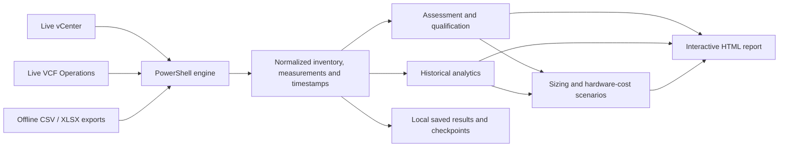

# MTAT user guide

Use this guide for assessment practice, metrics, peak interpretation, sizing and larger runs. For offline Operations exports, see [Operations export guide](OPS_EXPORT_GUIDE.md).

## Contents

- [Best practices](#best-practices)
- [How MTAT works](#how-mtat-works)
- [Metrics](#metrics)
- [Peak Active Memory](#peak-active-memory)
- [Sizing and savings](#sizing-and-savings)
- [Larger assessments and recovery](#larger-assessments-and-recovery)
- [Collection scheduling](#collection-scheduling)

## Best practices

### Collect a representative workload

1. Start with seven days and extend to 30 days when month-end, backups or batch processing matter. A quiet snapshot cannot establish production demand.
2. Compare the host and cluster counts with your intended inventory. Keep source identities intact when collecting from multiple vCenters.
3. Prefer Operations history when it already retains the necessary metrics. MTAT does not change collection policies or vCenter statistics levels.
4. For Operations, start with two parallel clusters. Use one if requests are throttled; try four only when appliance capacity permits. Direct vCenter collection remains sequential.
5. Review observed coverage, retention resolution and missing measurements. Missing intervals are not zeros; discarded source history cannot be reconstructed.

### Prepare complete offline inputs

Use timestamped host history for timelines. Export actual data rather than a screenshot or view definition. Include host identity, Active Memory and memory capacity; CPU and actual consumed memory support screening and sizing. Include cluster context or a matching supplemental mapping. Follow [Export from Ops](OPS_EXPORT_GUIDE.md).

Excel worksheets have a limit of 1,048,576 rows, including headers. Check source completeness before importing. Split by source, cluster or period, or use complete CSV exports where available. CSV avoids Excel's worksheet limit but still needs disk space and processing time. RVTools supplies inventory/snapshot context, not retained performance history.

### Interpret candidate screening

The Advanced Analytics Tiering Candidate column screens workloads. Yes requires peak/snapshot Active Memory below 50% and average CPU at or below 50%. No requires average Active Memory, peak Active Memory and average CPU all at least 75%. Other combinations are Review. Missing required measurements can produce CHECK DATA.

Validate physical DRAM, current tier/NVMe state, VM reservations, passthrough, pinned memory and other DRAM-only requirements separately before qualification or implementation. A Yes is not a hardware compatibility or performance certification. Confirm unusually high peaks against their source timestamps before excluding them.

### Plan capacity with explicit headroom

The refresh planner defaults to 85% consumed memory after the selected HA reserve. Adjust this planning ceiling to operational requirements; it is not a universal VMware utilization recommendation. Active Memory against usable DRAM is a separate guardrail from consumed memory against total memory. Start conservatively with tiering ratios, validate workload behavior, and use supported hardware configurations.

Enter actual prices, HA reserves and CPU assumptions. Compare tiered and DRAM-only alternatives using the same workload and headroom policy. Savings estimate hardware costs, not complete TCO or a procurement quote. See [Sizing](USER_GUIDE.md#sizing-and-savings).

### Share and retain results

Export one HTML report with the required collected ranges. Check that all intended sources and clusters are included. Use Hide real names when appropriate and inspect the resulting report before sharing. Customer/preparer text and free-form labels need your own review.

Keep reports, source exports, jobs and diagnostic logs in an approved location. They can contain inventory names. Saved data is local; deleting the downloaded application does not delete the saved assessment store. Use saved results for reopening and compatible checkpoints for recovery rather than recollecting completed work.

## How MTAT works

MTAT is a read-only assessment and planning tool. The PowerShell engine serves a local browser interface. Live collection reads inventory and measurements; offline import reads exported files. MTAT does not enable Memory Tiering or modify endpoint configuration.

### Engine

The versioned PowerShell script serves the local browser interface. Direct vCenter collection uses PowerCLI; Operations and offline imports do not require PowerCLI.

### Measurements and identity

Source, cluster and host identities remain separate. Active Memory is distinct from consumed and provisioned memory. CPU utilization is distinct from core utilization. Output memory is decimal GB, with whole-GB display and full calculation precision. Native source units require conversion; do not relabel a counter or strip its unit without checking its meaning.

History retains source timestamps where present. Charts use bounded retained/aggregated samples and cannot recreate a brief spike already averaged out at the source. See [Metrics](USER_GUIDE.md#metrics) and [Peak calculations](USER_GUIDE.md#peak-active-memory).

### Assessment and analytics

Baseline Assessment compares CPU, Active Memory and capacity and keeps configuration evidence separate. Advanced Analytics provides memory-band matrices, historical timelines when samples are available, threshold/persistence controls and sortable host/cluster breakdowns. Tiering Candidate is a workload screen; full qualification also depends on configuration and VM constraints.

A summary export has no historical timeline. A matrix of summary values does not establish time above a threshold. Cluster history uses available host measurements and current inventory context; historical placement and capacity changes can affect interpretation.

### Sizing and reporting

Sizing compares adding NVMe to existing hosts with refresh alternatives. It accounts for selected headroom, HA, workload and available VM-placement constraints. Missing configuration introduces assumptions that require validation. Prices are editable planning inputs.

HTML reports contain selected collected ranges, assessment, analytics and sizing content. Supported controls work without the MTAT engine; they cannot fetch uncollected data. Browser Print / Save as PDF produces a static document. Explicit report budgets can require a smaller scope.

### Local storage and recovery

Larger assessments use disk-backed storage and paged queries. Collection/import jobs expose progress and cancellation. Completed results and compatible unfinished jobs can be reopened or resumed. Live resume requires reconnection to the authorized matching source. Saved checkpoints do not store endpoint passwords or authentication tokens. Inventory facts and logs still need appropriate handling.

## Metrics

Availability depends on source version, permissions, retention and export layout. MTAT discovers supported Operations counters rather than assuming every environment exposes all of them.

| Measurement | Live vCenter | Live Operations, common key | Offline input |
| --- | --- | --- | --- |
| Host Active Memory | mem.active.average | mem\|active_average | Guest Active / Active values, with timestamped history when available |
| Host consumed memory | mem.consumed.average | mem\|consumed_average | Actual consumed counter; allocated VM memory is a separate proxy |
| Host CPU utilization | cpu.usage.average | cpu\|usage_average, cpu\|capacity_usagepct_average or cpu\|utilization_average | Explicit CPU utilization column |
| CPU core utilization | Available source measurements | cpu\|coreUtilization_average | Separate optional core-utilization column |
| Host memory capacity | Inventory hardware memory | mem\|totalCapacity_average, with mem\|host_provisioned as an alternative | Host capacity column with known units |
| CPU capacity | Inventory capacity | cpu\|capacity_provisioned or cpu\|totalCapacity_average | Optional capacity context |
| VM Active Memory | mem.active.average | mem\|active_average | Available VM facts or history |
| VM configured memory | VM inventory | mem\|guest_provisioned | Configured/provisioned VM memory |
| Cluster and host membership | Inventory relationships | Resource relationships | Cluster column or unambiguous mapping |
| Tier state, physical DRAM/NVMe | Available inventory/configuration | Discoverable, verified attributes where available | Only explicitly supplied and verified context |
| VM DRAM-only constraints | Available VM configuration | Often incomplete | Host-only exports cannot establish them |

Logical host capacity on a tiered host is not automatically physical DRAM. Validate the denominator before quoting sizing results. CPU core utilization does not replace CPU utilization.

### Derived results

- Average Active Memory describes observed demand over the selected range.
- Peak Active Memory is the sustained peak derived from observed hourly highs when history supports it; the single highest retained sample is kept separately.
- Cluster peak figures sum host peaks that can occur at different times.
- Threshold/persistence results describe available observed chart intervals, not missing time.
- Tiering Candidate uses the row's own peak/snapshot Active %, average Active % and average CPU %. Configuration qualification is separate.

Summary-only input cannot supply historical persistence. RVTools is useful for inventory and snapshot context but does not supply the retained history available from live collectors or timestamped Operations exports.

## Peak Active Memory

MTAT distinguishes average Active Memory, a sustained peak and the highest single retained sample. A snapshot or summary-only file does not establish sustained history.

### Sustained peak rule

For timestamped history, keep the highest Active Memory sample in each observed hour. Rank those hourly highs from highest to lowest and select the level reached or exceeded in at least 5% of those observed positions. With a short history the value remains the maximum. For example, with 168 hourly positions the ninth-highest hourly value determines the sustained peak; with 720 positions it is the 36th-highest.

One isolated spike can therefore remain visible as the highest sample without setting a much longer range's sustained peak. Repeated or sustained high demand still affects the result. Coarser source rollups constrain the available positions; missing time is not reconstructed.

### Host, cluster and chart values

Host percentages use the associated capacity denominator. Changes in historical capacity can affect comparison with current inventory capacity. A cluster's conservative summed host peaks are not a simultaneous cluster peak: hosts may peak at different times.

Timeline and threshold/persistence views use retained chart intervals. Their threshold is adjustable and is separate from the fixed sustained-peak calculation. Matrix bands from summary inputs describe distribution, not time above a threshold.

### Verify a surprising peak

1. Select the intended source, cluster and collected range.
2. Inspect Operations peak evidence where available, including decimal GB and UTC timestamp.
3. Open that host's Guest Active measurement at the source using the finest retained resolution.
4. Check capacity, source units, retention rollups and recent inventory changes.
5. Keep genuine workload demand in the assessment. Do not remove a measurement solely because it changes the conclusion.

A timestamp identifies a retained observation; it does not establish sub-interval behavior that the source no longer retains.

## Sizing and savings

### Planning sizes versus measured memory

MTAT separates round target-node planning inputs from measured inventory. Choose 256, 512, 768, 1,024, 1,536, 2,048, 3,072, 4,096, 6,144 or 8,192 GB, or enter Custom. Inputs mean the GB capacity displayed; they are not silently multiplied by a memory-unit conversion factor. Existing memory metrics still use decimal GB. The selector initially chooses the closest preset to the measured average host capacity, with no automatic Custom value.

In fixed-host mode, DRAM rounds upward to the next entry in the common-profile list: 128, 256, 384, 512, 768, 1,024, 1,536, 2,048, 3,072, 4,096, 6,144 and 8,192 GB. Above that catalog, the estimate rounds up in 256 GB steps. This never reduces required capacity, but those larger estimates and each DIMM/channel configuration require hardware validation. Target-node mode preserves the selected total capacity and ratio; Custom is an explicit planning input. These examples are not an OEM compatibility list.

The report uses the same target catalog. It also includes an explicitly selected Custom capacity, but does not add precise measured host averages as proposed new node sizes. The current 85% default consumed-memory planning ceiling, HA reserve, Active/DRAM guard, largest-VM placement checks and NVMe partition cap remain in effect. Memory quantities in GB are shown without fractional display values.

### Consumed-memory headroom

The refresh planner defaults to **85% consumed memory after HA**, leaving 15% free capacity on the usable hosts. It accepts 10-90%, warns above 85%, and rejects values outside that range. These thresholds are MTAT planning choices, not a universal VMware rule. The same policy applies to DRAM-only and tiered alternatives. In a tiered design, total memory is DRAM plus NVMe. Collected consumed values are time averages, so this forecast cannot guarantee a ceiling during unobserved bursts.

For consumed load M, total memory per node C, and selected ceiling U as a fraction:

- Minimum usable hosts for capacity = `ceil(M / (C x U))`. Other constraints can require more hosts. Add HA reserve hosts afterwards.
- For a fixed usable-host count N, minimum capacity per host = `M / (N x U)`, rounded up and increased for active-memory, CPU, VM placement or platform limits as needed.
- Consumed forecast after HA = `M / ((total hosts - HA hosts) x C)`. Normal-operation utilization counts all deployed hosts and is lower when HA is reserved.
- The active-memory forecast also uses DRAM on the usable hosts, setting aside identified DRAM-only VM memory first. Its separate 50% guardrail remains.

For example, 2,900 GB consumed with Custom 1,000 GB nodes and one HA host needs `ceil(2900 / 800) + 1 = 5` total hosts at an 80% ceiling. After HA it uses 72.5% of memory; normal operation is 58%. Reducing the ceiling to 70% needs six total hosts and uses 58% after HA.

VMware's [VCF 9 Memory Tiering performance study](https://www.vmware.com/docs/memtier-vcf9-perf) recommends active memory at or below 50% of DRAM; 50-75% requires workload testing and monitoring, and above 75% generally risks significant performance loss. This is different from consumed memory divided by total tiered capacity. The [vSphere 9 performance best practices](https://www.vmware.com/docs/vsphere-esxi-vcenter-server-90-performance-best-practices) call for working-set sizing, overhead and HA capacity; they do not establish a universal consumed-memory percentage for every host. Validate workload bursts and operational requirements before using projected savings.

This describes what the Sizing tab (tab 4) and the Sizing section of the customer report calculate, what they take into account, and where they stop being reliable. It was written from the code, so if a result disagrees with this page, the result is the thing to investigate.

### What it answers

Two questions, side by side:

1. **Add NVMe to existing hosts (brownfield).** How much NVMe would each host need, and what does that cost compared with buying the same extra capacity as DRAM?
2. **Refresh onto new hosts (greenfield).** How many new hosts, and of what size, are needed with Memory Tiering compared with DRAM only, and which is cheaper?

Savings are a hardware comparison against a DRAM-only alternative of the same capacity. They are not a quote and not a performance guarantee.

### What goes in

| Input | Where it comes from | Used for |
|---|---|---|
| Host DRAM | Collected (vCenter or Ops) | Size of the fast tier, per-host NVMe |
| Peak Active Memory | Collected, sustained peak (level reached in at least 5% of hours) | The 50% rule, host count in a refresh |
| Consumed memory | Collected | Whether a refresh has enough total capacity |
| CPU usage | Collected | Refresh host count (kept at or below 80% busy) |
| Largest VM, DRAM-only VMs | Collected (VM inventory) | VMs that must stay in DRAM, whether a VM fits on a node |
| Tier state and existing NVMe | Collected where available | Sizes only the NVMe still missing on tiered hosts |
| Prices, chassis cost, HA hosts, CPU multiplier, mirroring | You enter them | Every cost figure |

Defaults: DRAM $100 per GB, NVMe $0.25 per GB (doubled when software mirroring is on), chassis $15,000, one HA host, 1.0x CPU. Change them to real quotes before showing savings to a customer.

### How the numbers are built

**The 50% rule.** Peak Active Memory should stay at or below 50% of the DRAM that tiering can use. DRAM that DRAM-only VMs occupy is taken out of that DRAM first. Above 50%, hot memory spills toward NVMe and performance risk rises. The badge shows LOW RISK up to 50%, ELEVATED up to 80%, THRASH RISK above that.

**Brownfield.** For each host, NVMe = DRAM x ratio, capped at 4,398 GB per host and at 1:4. Cost of the NVMe is its price (doubled if mirrored). Value is the NVMe capacity added multiplied by the DRAM price, which is what that capacity would cost as DRAM. Net savings is value minus cost. If hosts already run tiering, only the NVMe still needed to reach the target counts, host by host.

**Refresh, target node size.** For a chosen node size:
- DRAM-only hosts = the largest of (consumed memory / (node size x selected ceiling)), (CPU load / 80%), and the number of nodes needed to hold the DRAM-only VMs, plus HA hosts.
- Tiered hosts = the largest of (consumed memory / ((DRAM + NVMe) x selected ceiling)), CPU, (Active load / (50% x DRAM)), and DRAM-only VM packing, plus HA hosts.
- Cost of each = hosts x (chassis + memory). Net savings = DRAM-only cost minus tiered cost. It can be negative: a tiered design that needs an extra host to keep Active Memory within 50% may cost more.

**Refresh, target host count.** The reverse: given a host count, it works out the memory per host needed, with DRAM rounded up to the common planning profiles above, with a 128 GB minimum.

**Node size starts at the closest common preset to the average host DRAM.** Custom is selected only when you choose it.

**VM density** is an estimate: extra memory divided by a 17 GB typical VM profile.

### Best practices

- Use 1:1 as the starting point. Higher ratios need additional workload assessment because peak Active Memory has to be proportionally lower.
- Use a long collection window (7 to 30 days) so the sustained peak includes month-end or batch cycles. A 24-hour window can miss them.
- Confirm DRAM-only VMs (passthrough, vGPU, pinned memory, Latency Sensitivity High, Fault Tolerance). Each one keeps its memory in DRAM and reduces what tiering can do.
- Confirm whether tiering is already on. Savings are overstated if it is and the tool assumed it was not.
- Enter real prices. The result scales almost directly with the DRAM price.
- Check the savings against the DRAM price table in the report. A conclusion that flips at plus or minus $25 per GB is not a firm one.
- Treat any flagged cluster as a lead to validate, not a result to quote.

### Caveats

- **Assumptions when data is missing.** If tier state is not reported, hosts are assumed not tiered with all memory as DRAM. If VM details could not be verified, no DRAM-only VMs are assumed beyond those identified. If counters cover less than 80% of the window, the Active peak may be low. Each assumption is printed as a note. Tab 2 still shows these as unverified.
- **Clusters above 50% are still sized.** In the report, the add-NVMe scenario uses 2:1 DRAM:NVMe for those clusters and flags them. This is a lower-risk starting point, not a validated fit.
- **Cluster peaks are sums of host peaks.** Hosts peak at different times, so a cluster figure is conservative, not a simultaneous peak.
- **Hardware only.** It does not include licensing, power and cooling, rack space, networking, drive availability, drive endurance, or the labor of changing hosts. Brownfield assumes each host has room for the NVMe devices.
- **Rounded display.** Memory is shown in whole GB. Calculations keep full precision.
- **Snapshot of history.** Results describe the collected window. They do not predict growth.
- **Imports.** Host exports do not carry VM inventory or physical tier breakdown, so DRAM-only VM handling and tier state rest on the assumptions above.

## Larger assessments and recovery

MTAT uses local disk storage, bounded API batches and paged result queries to reduce browser memory pressure. These controls do not establish an unlimited supported estate size. Total hosts, metrics, observations, source latency, storage speed and available memory all affect the run.

### Collect efficiently

For Operations, select 1, 2 or 4 parallel clusters, with 2 as the default. Each cluster collects a selected latest snapshot first, then its longest selected history. Compatible longer history is reused for shorter ranges. Direct vCenter collection remains sequential. Increase concurrency only when the endpoint can support the extra requests.

Use a representative window and required scope. A lightly loaded cluster can still have expensive history and relationship queries. Follow progress and duration logs to distinguish waiting for the endpoint from local publication/indexing.

### Avoid incomplete source exports

Excel has a worksheet limit of 1,048,576 rows. A timestamped export grows with hosts multiplied by retained observations. Use complete CSV exports or split by source, cluster or time window, and reconcile host and observation counts. MTAT cannot recover rows that the exporting application omitted.

### Import and explore

Use the import option that preserves observations when historical analytics are required. Larger imports can be stored locally rather than loaded into the browser in full. Search and page through long host, cluster and VM lists. A summary-only export remains a summary after import.

### Cancel and recover

Use the visible job controls rather than repeatedly clicking Process Import or Analyze. Cancellation keeps finished checkpoints. Reopen saved results after a restart, or resume compatible unfinished work. Reconnect to the original authorized inventory for live resume. A changed collector or incompatible job configuration can require a new collection while completed saved facts remain available.

Preserve source files until the imported scope and counts are confirmed. Do not point two active engines at one writable saved-data store. Copy the store while stopped if you need an independent test or backup.

### Reports and limits

HTML exports have explicit browser/data budgets. When a complete report will not fit, export fewer clusters or a shorter period and retain the underlying assessment. Reducing a report selection does not recreate missing source data or establish that a partially loaded scope is complete.

Do not treat local fixture tests as a maximum supported size or production throughput guarantee. Live endpoint, native Windows executable and representative customer-scale validation remain separate checks.

## Collection scheduling

Operations collection supports 1, 2 or 4 concurrent clusters. The default is 2. Within a cluster, a selected latest sample is collected first, followed by the longest selected historical range. Compatible history is reused for shorter ranges. Counter discovery is cached within a job, and completed results are published through a coordinator.

Direct vCenter collection stays sequential. Its current PowerCLI/SDK session handling is not shared across parallel collection lanes.

Requests, retries, batches and local loading remain bounded. Each cluster/range task has a two-hour runtime ceiling and a job has a 24-hour ceiling. A failed range does not discard other completed ranges. Cancellation preserves completed checkpoints; an in-flight operation may take time to finish before the job releases ownership.

Request and task logs distinguish collection from publication/indexing time without recording authentication headers or request bodies. Start at two parallel clusters, use one when Operations throttles, and consider four when appliance capacity permits. Concurrency overlaps work but cannot guarantee a collection duration or remove retention and source-export limits.
